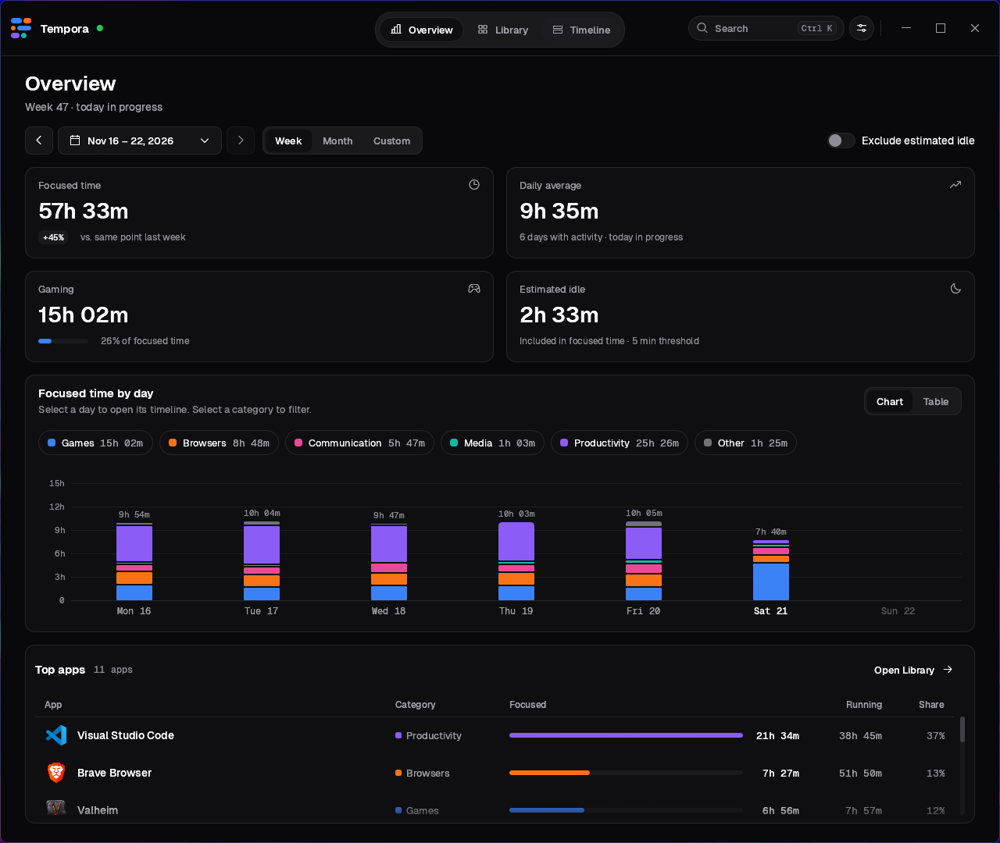
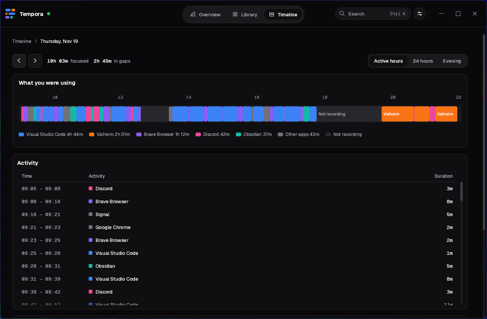
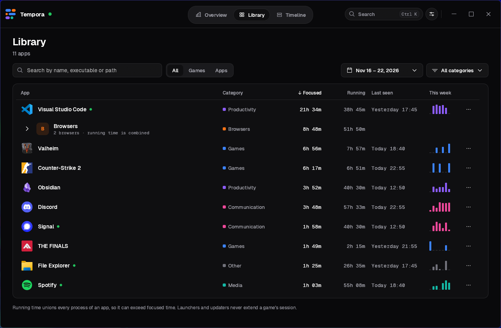

<p align="center">
  
</p>

<h1 align="center">Tempora</h1>

<p align="center">
  See where your time on Windows goes: which games you played, which apps you worked in, and for how long.<br>
  Everything stays on your PC.
</p>

<p align="center">
  <a href="#download">Download</a> ·
  <a href="#privacy">Privacy</a> ·
  <a href="#build-from-source">Build from source</a>
</p>

<p align="center">
  
</p>

## Features

- **Recognizes games by itself.** Tempora reads the same game list Windows uses for the Game Bar, so titles from Steam, Epic, Riot, Xbox or anywhere else show up under Games with their real names. A game installed twice counts as one.
- **Focused and running time.** Focused time is how long an app was in front. Running time is how long it was open, including the background. Leave a game running while you read a guide in your browser, and you'll see both.
- **A timeline of every day.** See what you used hour by hour. Bursts of quick switching fold into one row instead of flooding the list.
- **A library of everything you've used,** with weekly trends, sorting and search. Rename an app, change its category or group installs together; your edits always win over automatic recognition.
- **Private by design.** No account, no cloud, no network access. Tempora never reads window titles, URLs, keystrokes or screens. You can exclude any app or pause recording from the tray.
- **Light on your PC.** A small recorder in the notification area does the tracking; the dashboard only opens when you want to look.

## Screenshots

**Timeline.** One day, hour by hour, and every stretch of activity behind it.



**Library.** Every app with its focused and running time and a trend for the week.



<sub>Screenshots show sample data.</sub>

## Download

Tempora runs on Windows 10 (1809) and Windows 11, x64. Get it from the [Releases](../../releases) page:

- **Installer** (`Tempora-Setup-<version>-x64.exe`): installs for your account, with no administrator rights needed.
- **Portable zip** (`Tempora-<version>-x64-portable.zip`): extract it to a folder you'll keep and run `tempora.exe`. Keep `tempora-recorder.exe` next to it.

The builds aren't code-signed yet, so Microsoft Defender SmartScreen may warn you the first time. Choose **More info**, then **Run anyway**.

### Getting started

On first run, Tempora starts its recorder and asks two things: whether to track all apps or only the ones you pick, and whether to start when you sign in. That's it.

- **Overview** shows your week: focused time, daily average and how much of it was gaming. Click a day to open its timeline.
- **Library** compares apps by focused and running time. Right-click any app to edit its name or category, group it with another install, stop tracking it or delete its history.
- Closing the dashboard doesn't stop recording. The recorder lives in the notification area; use it to pause, resume or quit.

## Privacy

Tempora works offline and makes no network requests. It records which app is in front, which apps are open and when you were idle. It never records window titles, URLs, keystrokes, screenshots, track names or who you're talking to.

Your history is a local SQLite database in `%LOCALAPPDATA%\Tempora`. Export it to CSV or back it up from **Settings**.

The recorder uses documented, read-only Windows APIs. It runs outside your games: no code injection, no reading game memory, no overlays, no input hooks, no drivers, so it's safe alongside anti-cheat.

<details>
<summary><b>Exactly what the recorder reads</b></summary>

While recording, it checks the foreground app and idle time about every 2 seconds, and running apps about every 10 seconds.

| Purpose | Windows APIs |
| --- | --- |
| Foreground app | `GetForegroundWindow`, `GetWindowThreadProcessId`, `IsWindowVisible`, `GetWindowLongW`, `DwmGetWindowAttribute` |
| Running apps | `EnumWindows`, `EnumChildWindows`, `CreateToolhelp32Snapshot`, `Process32FirstW`/`NextW`, `OpenProcess` (`PROCESS_QUERY_LIMITED_INFORMATION` only), `QueryFullProcessImageNameW`, `GetPackageFamilyName`, `GetApplicationUserModelId` |
| Recognizing games | `RegOpenKeyExW`, `RegGetValueW` read Windows' game list in `HKEY_CURRENT_USER\System\GameConfigStore`. |
| Naming apps | `GetFileVersionInfoSizeW`, `GetFileVersionInfoW`, `VerQueryValueW` read executable descriptions and product names from disk. `SHParseDisplayName` and `SHGetFileInfoW` look up Store app names with the shell. The lookup uses `CoInitializeEx`, `CoTaskMemFree` and `CoUninitialize` to manage its Windows resources. |
| Local file checks | `QueryDosDeviceW` checks the drive mapping. Automatic file lookups skip network locations, redirected drives, and paths through symlinks or junctions. |
| Fullscreen games | `GetWindowRect`, `MonitorFromWindow`, `GetMonitorInfoW` |
| Idle time | `GetLastInputInfo`, `GetTickCount64`: when you last used the keyboard or mouse, never what you typed |
| Lock, sleep, sign-out | `ProcessIdToSessionId`, `WTSQuerySessionInformationW`, `WTSRegisterSessionNotification` |
| Tray, dashboard and start at sign-in | `Shell_NotifyIconW`, `TrackPopupMenu`, a named pipe limited to your account and session, and `RegSetKeyValueW`/`RegDeleteKeyValueW` on your own `...\CurrentVersion\Run` entry |

</details>

<details>
<summary><b>How apps are recognized</b></summary>

Games come from Windows' own list of games, the one the Game Bar uses, so a title from any store or launcher lands in **Games** with its proper name. Steam and Riot games are matched to their install folders. An app Windows lists without a game ID counts as a game once it has been seen running fullscreen. Installs of the same game in two places are grouped into one entry. Other apps are named from their executable's description, or from the Start menu for Store apps.

Anything recognized automatically can be corrected: your edits always win.

</details>

## Uninstall

- **Installer:** uninstall Tempora from **Settings → Apps → Installed apps**. You'll be asked whether to delete your recorded history; the default keeps it.
- **Portable:** turn off start at sign-in in Settings, quit from the tray and delete the folder. To erase your history too, delete `%LOCALAPPDATA%\Tempora`.

## Build from source

You need Rust 1.95 or newer and the Windows MSVC build tools with the Windows SDK.

```bash
cargo build --release --locked
cargo test --locked
```

This builds `tempora.exe` (the dashboard) and `tempora-recorder.exe` into `target\release`; keep them in the same folder. To build the portable zip and, with [Inno Setup 6](https://jrsoftware.org/isinfo.php) installed, the installer into `dist\`, run this from Git Bash:

```bash
bash scripts/package.sh
```

<details>
<summary><b>Signing the installer</b></summary>

Put a code-signing certificate with its private key in your user's Personal certificate store, and the Windows SDK's `signtool.exe` on `PATH`. Build the binaries with `bash scripts/package.sh` first. Then, with `version` set to the version in `Cargo.toml`, `thumbprint` to the certificate's thumbprint and `ISCC.exe` on `PATH`:

```bash
MSYS2_ARG_CONV_EXCL='*' ISCC.exe "/DAppVersion=$version" /DSign=1 \
  "/STemporaSigning=signtool.exe sign /sha1 $thumbprint /fd SHA256 \$f" \
  'installer\Tempora.iss'
```

This signs Setup and its uninstaller. For a signed portable zip, sign the executables before archiving them.

</details>

## Contributing

Bug reports, wrong recognitions and pull requests are welcome. [CONTRIBUTING.md](CONTRIBUTING.md) explains how the code is laid out and the checks to run. To report a security issue privately, see [SECURITY.md](SECURITY.md).

## License

[MIT](LICENSE).
